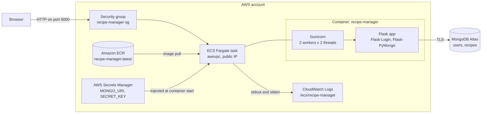
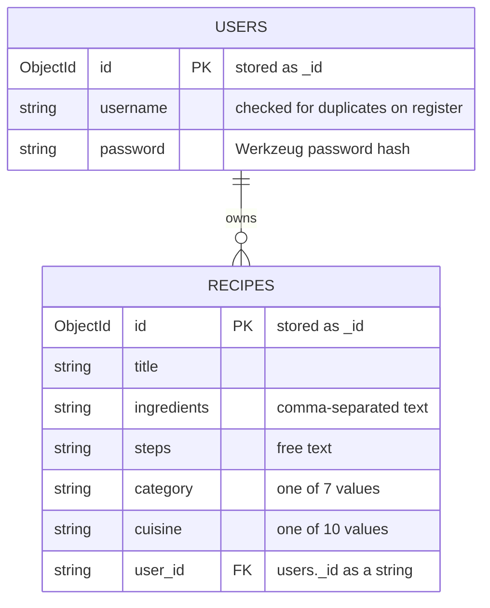
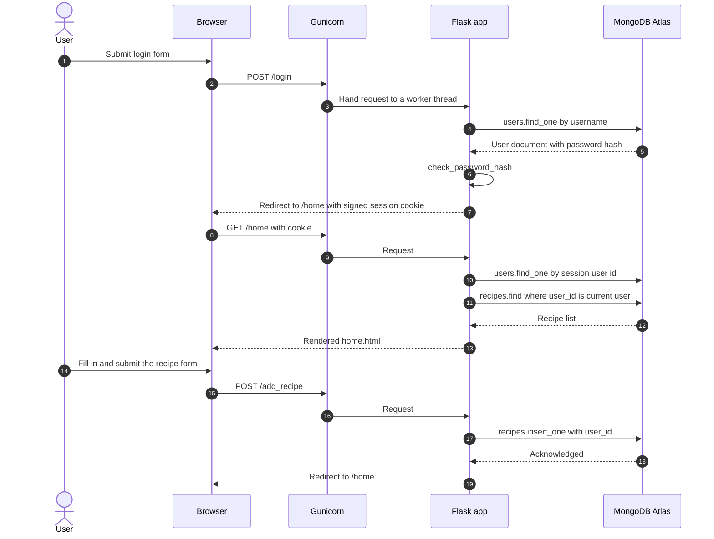
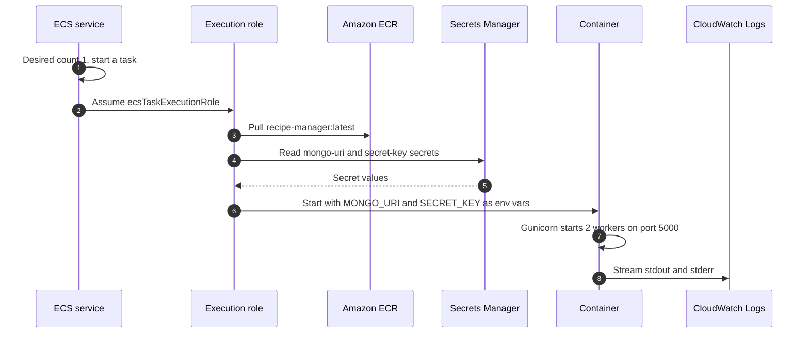
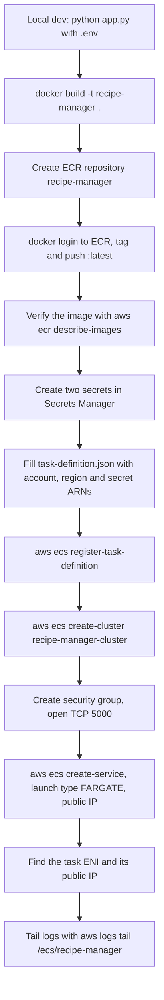

# Recipe Manager: overview, system design and workflow

## Overview

### Problem

A personal recipe collection needs accounts, so each person sees only their own recipes, and it needs to run somewhere
other than a laptop without putting database credentials inside the code or the container image.

### What it does

Recipe Manager is a Flask web app backed by MongoDB Atlas. Users register, log in and create, view, edit and delete
recipes with a title, ingredients, steps, a category and a cuisine. Every recipe query is filtered by the logged-in
user's ID, so users only ever see their own recipes.

The app is containerized with Docker and served by Gunicorn. The image is pushed to a private Amazon ECR repository
and runs as an AWS ECS Fargate task. `MONGO_URI` and `SECRET_KEY` live in AWS Secrets Manager and are injected into the
container at start, and container logs go to CloudWatch Logs.

## System design

### Components

| Component | Where | Role |
|---|---|---|
| Flask app | `app.py` | Routes, form handling and rendering. Reads `SECRET_KEY` and `MONGO_URI` from the environment and fails at startup if either is missing. |
| Authentication | Flask-Login, `werkzeug.security` | `login_user` / `logout_user`, `@login_required` on every recipe route, passwords hashed with `generate_password_hash` and checked with `check_password_hash`. |
| Database client | Flask-PyMongo (`mongo.db.users`, `mongo.db.recipes`) | Connects to MongoDB Atlas using `MONGO_URI`. |
| Templates and static files | `templates/`, `static/` | Jinja2 pages with Bootstrap 5 and Bootstrap Icons from a CDN. `static/app.js` handles the dark and light theme toggle (saved in `localStorage`) and client-side form validation, including password confirmation. |
| WSGI server | Gunicorn in the `Dockerfile` | `--workers 2 --threads 2 --timeout 60`, bound to `0.0.0.0:5000`. |
| Container image | `Dockerfile` | `python:3.12-slim`, installs pinned `requirements.txt`, copies the app, exposes port 5000. `.dockerignore` keeps `.env`, `venv/` and `.git/` out of the image. |
| Registry | Amazon ECR | Private repository `recipe-manager`, tag `latest`. |
| Secrets | AWS Secrets Manager | `recipe-manager/mongo-uri` and `recipe-manager/secret-key`, referenced by ARN in the task definition. |
| Runtime | Amazon ECS on Fargate | Task definition `recipe-manager-task` (256 CPU units, 512 MiB, `awsvpc`), cluster `recipe-manager-cluster`, service `recipe-manager-service` with a desired count of 1 and a public IP. |
| Network | Security group `recipe-manager-sg` | Inbound TCP 5000 from `0.0.0.0/0`. |
| Logs | CloudWatch Logs | Log group `/ecs/recipe-manager`, stream prefix `ecs`, through the `awslogs` driver. |

### Architecture

### Data model

Two MongoDB collections. The link between them is kept by the application: each recipe stores its owner's `_id` as a
string in `user_id`, and every recipe read or write filters on it.

| Field | Allowed values (from `app.py`) |
|---|---|
| `category` | Breakfast, Lunch, Dinner, Dessert, Snack, Vegan, Beverage |
| `cuisine` | Italian, Indian, Chinese, Mexican, Thai, Japanese, American, Mediterranean, French, Middle Eastern |

Username uniqueness is enforced by a `find_one` check in the `register` route, not by a database index.

### Routes

| Route | Methods | Login | What it does |
|---|---|---|---|
| `/` | GET | no | Redirects to `/login` |
| `/register` | GET, POST | no | Shows the form; on POST hashes the password and inserts the user, or returns 400 if the username exists |
| `/login` | GET, POST | no | On POST checks the hash, calls `login_user` and redirects to `/home`, or returns 401 |
| `/logout` | GET | yes | Logs out and redirects to `/login` |
| `/home` | GET | yes | Lists recipes where `user_id` is the current user |
| `/add_recipe` | GET, POST | yes | Shows the form with category and cuisine lists; on POST inserts the recipe with the current `user_id` |
| `/todos/<id>` | GET | yes | Shows one recipe; 400 for a malformed ID, 404 if it does not exist or belongs to someone else |
| `/update_todo/<id>` | GET, POST | yes | Same ownership check, then `$set` on the five recipe fields |
| `/delete_todo/<id>` | GET, POST | yes | GET shows a confirmation page; POST deletes after the ownership check |

The `todos` and `todo` names in three routes are left over from the app's origin and work the same as recipe routes.

## Workflow

### Request: log in and add a recipe

### Container start on Fargate

### Deployment steps

Steps A to E publish the image; steps F to M deploy it to Fargate. The README has the exact commands and screenshots
of the ECR repository, the ECS cluster and the running app.

## Tech stack

| Tool | Used for | Why this and not the alternative |
|---|---|---|
| Flask | Web framework | Small and explicit for a handful of routes with server-rendered pages. Django brings an ORM and admin built for relational databases, which this app does not need. |
| Flask-Login | Sessions and route protection | Standard Flask extension for "who is logged in" with a `@login_required` decorator. Writing session handling by hand is more code and more risk. |
| Werkzeug password hashing | Storing passwords | Salted, slow hashes out of the box, and Werkzeug is already a Flask dependency. |
| MongoDB Atlas with Flask-PyMongo | Data storage | A recipe is one self-contained document, and Atlas is managed, so there is no database server to run. PostgreSQL would work equally well but needs a schema and migrations. |
| Jinja2, Bootstrap 5, vanilla JS | Front end | Server-rendered pages need no build step. React would add a separate front-end project for a few forms. |
| Gunicorn | Production server | Flask's built-in server is for development only. Gunicorn runs multiple workers and threads with a request timeout. |
| Docker (`python:3.12-slim`) | Packaging | One image runs the same on a laptop and on Fargate. The slim base keeps the image smaller than the full Python image. |
| Amazon ECR | Image registry | Private and integrated with ECS through IAM. A public Docker Hub repository would expose the image. |
| AWS Secrets Manager | Secrets | Values are encrypted at rest and access is logged. Plain environment variables in a task definition are visible to anyone who can read the task definition. |
| ECS on Fargate | Running the container | No EC2 instances to provision or patch. EKS is more than one container needs. App Runner or Elastic Beanstalk hide more of the setup, while Fargate gives direct control of the task definition, networking and secrets. |
| CloudWatch Logs | Logs | Fargate tasks are ephemeral; without a log driver the logs of a crashed task are lost. |

## Trade-offs and what to change at scale

| Current choice | Cost | At scale |
|---|---|---|
| Container port exposed directly with a public IP | Plain HTTP, scanner traffic, and the IP changes when the task is replaced | Application Load Balancer with an ACM certificate for HTTPS, a DNS name, and the task security group open only to the ALB |
| Desired count 1, no autoscaling | One task, so a restart means a short outage | Two or more tasks behind the ALB, target-tracking autoscaling on CPU or requests |
| Manual CLI deployment with the mutable `latest` tag | Easy to deploy the wrong build, no rollback history | CI/CD (for example GitHub Actions) that builds, tags images with the commit SHA, updates the task definition and runs `ecs update-service` |
| No CSRF tokens on forms | Cross-site requests could submit forms for a logged-in user | Flask-WTF `CSRFProtect` |
| Logout uses GET | Logout can be triggered by any link or image on another page | Make logout a POST |
| Username uniqueness checked in code only | Two simultaneous registrations could create duplicates | A unique index on `users.username` |
| No index on `recipes.user_id`, no pagination | `/home` slows down as the collection grows | Index `user_id`, paginate the list |
| Ingredients and steps stored as plain strings | Cannot search or filter by ingredient | Store arrays, add a text index |
| Bare `except` around `ObjectId` parsing | Hides unexpected errors as "Invalid ID" | Catch `bson.errors.InvalidId` only |
| No tests, no health check in the image | Regressions and stuck containers go unnoticed | pytest with a test database, a `/health` route used by the ALB and ECS |
| Container runs as root | Larger blast radius if the app is compromised | Add a non-root user in the `Dockerfile` |
| Response time and uptime not measured | p95 latency —, uptime — | CloudWatch metrics and alarms, ALB access logs |

What already works well for scaling: sessions are signed cookies, not server memory, and all data is in Atlas, so any
number of identical tasks can serve any request.

## Glossary

| Term | Meaning |
|---|---|
| Flask | A small Python web framework. |
| WSGI | The Python standard interface between a web server and a web app. |
| Gunicorn | A production WSGI server that runs several worker processes. |
| Worker and thread | Gunicorn runs 2 worker processes, each with 2 threads, so up to 4 requests are handled at once. |
| Flask-Login | Flask extension that tracks the logged-in user in the session. |
| Session cookie | A cookie signed with `SECRET_KEY` that stores the user's session in the browser. |
| Password hash | A one-way, salted transformation of a password; the original cannot be read back. |
| MongoDB Atlas | MongoDB's managed cloud database service. |
| Collection | MongoDB's equivalent of a table; here `users` and `recipes`. |
| ObjectId | MongoDB's default 12-byte document ID. |
| Docker image | A packaged file system and start command for a container. |
| Amazon ECR | AWS's private container image registry. |
| Amazon ECS | AWS's container orchestration service. |
| Fargate | ECS launch type where AWS runs the servers; you only define the task. |
| Task definition | The ECS blueprint: image, CPU, memory, ports, secrets and logging. |
| Service | ECS object that keeps the desired number of tasks running and replaces failed ones. |
| Cluster | A logical grouping of ECS services and tasks. |
| awsvpc | Network mode that gives each task its own network interface (ENI) and IP. |
| Execution role | The IAM role ECS uses to pull the image and read secrets before the container starts. |
| AWS Secrets Manager | AWS service that stores and encrypts secrets and logs access to them. |
| Security group | A virtual firewall that controls inbound and outbound traffic. |
| CloudWatch Logs | AWS log storage and search. |
| ALB | Application Load Balancer: routes HTTP and HTTPS traffic to tasks. |
| CSRF | Cross-site request forgery: another site makes the browser send a request as the logged-in user. |
